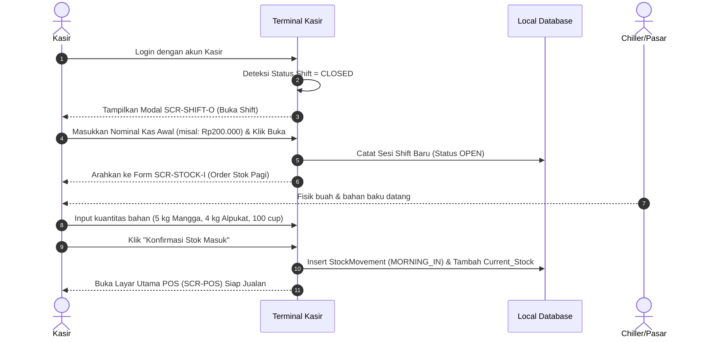
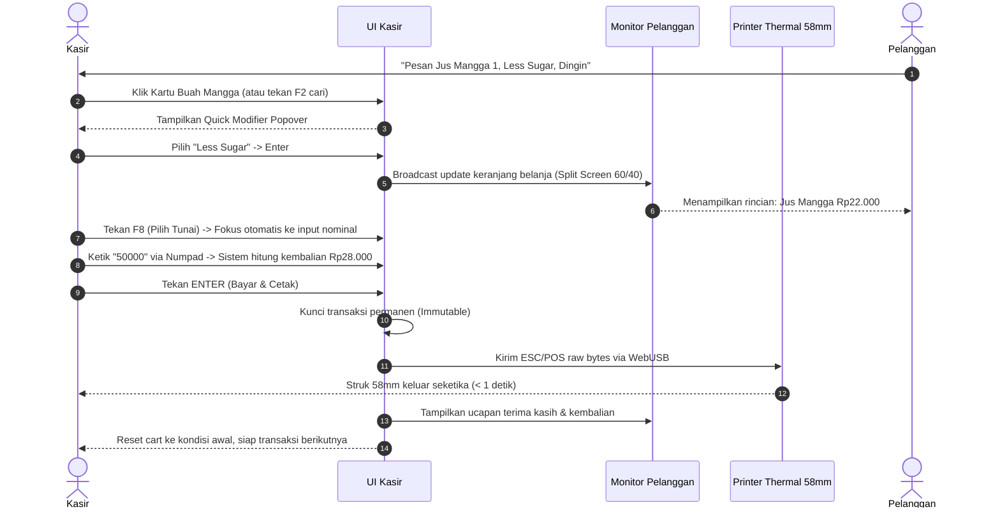
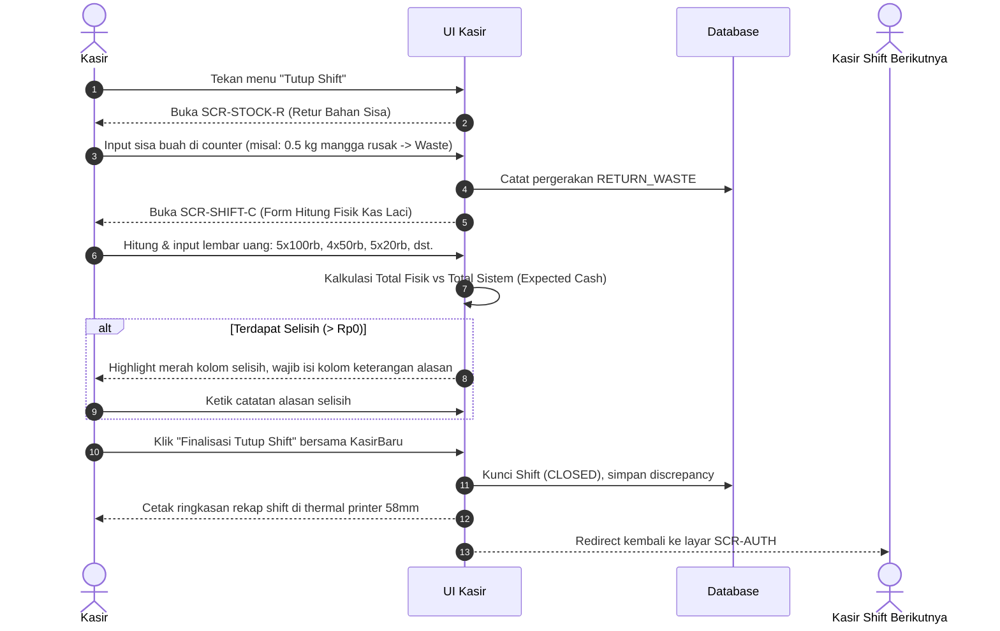
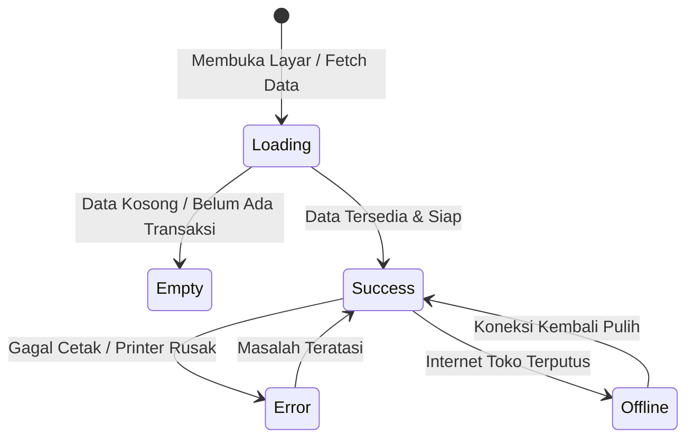

# DESIGN BRIEF: VITAMINE SMART POS & INVENTORY SYSTEM
**Role:** Senior UI/UX Specialist — F&B Retail & Quick Service Beverage  
**Produk:** VITAMINE POS & Dashboard Operasional Outlet  
**Status Dokumen:** Ready for Implementation Baseline  
**Dokumen Terkait:** [PRD.md](file:///d:/MRIOR/VITAMINE/PRD.md)  

---

## 1. Design Principles (3 Aturan Wajib)

Setiap desainer dan pengembang yang membangun antarmuka sistem VITAMINE wajib mematuhi 3 aturan mutlak ini:

```
+-----------------------------------------------------------------------------------+
| 1. SUB-SECOND ERGONOMICS (Mouse & Numpad Speed First)                             |
|    Setiap tindakan kasir (pilih menu, tambah modifier, bayar, print) wajib        |
|    dapat dieksekusi dalam <= 2 interaksi fisik tanpa hunting menu.                 |
+-----------------------------------------------------------------------------------+
| 2. CHROMATIC FRUIT SALIENCE ON CALM CANVAS                                        |
|    Kartu buah wajib memancarkan kesegaran alami yang menggiurkan, sementara       |
|    furniture UI (sidebar, header, background) wajib bernuansa tenang & netral    |
|    agar kasir tidak lelah mata selama shift 8 jam kerja.                          |
+-----------------------------------------------------------------------------------+
| 3. FAIL-CLOSED FINANCIAL TRANSPARENCY                                             |
|    Tidak ada perubahan kas atau stok tanpa konfirmasi visual eksplisit.          |
|    Status stok, selisih kas opname, dan print confirmation wajib terbaca jelas    |
|    dari jarak 60 cm dengan kontras tegas (zero ambiguity).                        |
+-----------------------------------------------------------------------------------+
```

### Rationale Keputusan:
1. **Sub-Second Ergonomics:** Lingkungan kasir jus buah saat antrean makan siang sangat bising dan ritmis. Kasir menggunakan PC desktop dengan mouse di tangan kanan dan tangan kiri bersiaga di numpad/keyboard. Mengandalkan klik mouse berulang untuk hal sepele (seperti klik modal konfirmasi berlebih) akan memicu antrean panjang.
2. **Chromatic Fruit Salience on Calm Canvas:** Jus adalah produk visual yang membangkitkan selera makan (*appetite appeal*). Warna-warna buah alami (jeruk sunkist, alpukat mentega, semangka merah) menjadi penanda navigasi visual tercepat bagi kasir dibanding membaca teks. Kanvas netral abu-abu arang (*slate*) dan *off-white* memastikan kontras warna buah berdiri menonjol tanpa membuat layar kasir terlihat murahan.
3. **Fail-Closed Financial Transparency:** Selisih kas dan sisa bahan baku buah mudah memicu konflik kerja antara kasir dan owner. Indikator selisih wajib hadir dengan warna tegas (merah tebal untuk minus, hijau untuk balance) tanpa angka tersembunyi.

---

## 2. Visual Direction

### 2.1. Mood & Atmosfer
- **Keywords:** *Fresh, Crisp, Organic Modernism, Energetic Precision, High-Contrast Efficiency.*
- **Sensasi Pengalaman:** Kasir merasa seperti mengemudikan cockpit instrumen modern yang gesit; Pelanggan di monitor display melihat sajian buah segar berkilau air es yang sehat dan membangkitkan dahaga; Owner melihat dashboard bisnis layaknya analitik fintech modern kelas atas.

### 2.2. Referensi & Benchmark Desain
- **POS & Catalog Grid:** *Toast POS Modern Retail* & *Square for Restaurants* — Layout grid modular yang memisahkan katalog visual buah di 65% area kiri dan keranjang pesanan *sticky* di 35% area kanan.
- **Dashboard Eksekutif Owner:** *Linear.app & Apple Health Metrics* — Menggunakan dark mode elegan (`#0F172A`), kartu KPI dengan ambient radial glow lembut, angka statistik dengan animasi rolling counter (`framer-motion`), dan diagram garis monokromatik bergradasi halus.
- **Customer Promo Display:** *Aesop / Gentle Monster Visual Kiosk* — Tipografi besar yang percaya diri, layout bersih tanpa elemen ramai yang mengalihkan perhatian, serta transisi cross-fade foto buah definisi tinggi.

### 2.3. Anti-Patterns (Apa yang Diharamkan)
- **DILARANG tombol abu-abu flat ala Windows 98 / Java Swing:** Sistem POS bukan program kasir minimarket jadul tahun 2000-an.
- **DILARANG teks di bawah 13px pada layar kasir:** Kasir berdiri di meja kasir berjarak 50-70 cm dari monitor PC. Teks kecil memaksa kasir membungkuk.
- **DILARANG dialog konfirmasi bertingkat (*Modal Inception*):** Tombol "Hapus Item" atau "Selesai Bayar" tidak boleh memunculkan 2 popup konfirmasi berturut-turut.
- **DILARANG efek 3D skeumorphic plastik berlebihan:** Hindari ikon buah 3D glossy kartun anak-anak. Gunakan foto buah asli resolusi tinggi yang dipotong rapi dengan sudut membulat elegan (*clean cut-out*).

---

## 3. Design Tokens

### 3.1. Color Palette & Semantic Roles

```
[ Primary Citrus ]     [ Fresh Lime ]         [ Pulp Berry ]         [ Sunshine Lemon ]
#FF6B00                #10B981                #E11D48                #F59E0B
Brand, Checkout CTA    In-Stock, Cash Match   Out-of-Stock, Return   Low Stock (<3 cup)
```

| Token Name | Hex Code | Semantic Role | Rationale Penggunaan |
| :--- | :--- | :--- | :--- |
| `color-brand-primary` | `#FF6B00` | Tombol CTA Utama, Badge Aktif, Border Seleksi | **Citrus Sunrise Orange:** Warna jeruk segar yang membangkitkan selera dan memandu fokus mata kasir ke tombol "Bayar & Cetak". |
| `color-brand-hover` | `#E05E00` | State Hover tombol primary | Memberikan feedback visual kedalaman saat cursor mouse berada di atas tombol. |
| `color-success` | `#10B981` | Stok Cukup, Kas Opname Pas/Surplus, Transaksi Berhasil | **Fresh Lime Green:** Simbol kesegaran sayur/buah sehat sekaligus indikator finansial yang aman. |
| `color-danger` | `#E11D48` | Stok Habis, Selisih Kas Minus, Retur Buah Busuk (*Waste*) | **Rich Pulp Berry:** Warna merah semangka/strawberry yang tegas sebagai peringatan kritis tanpa membuat pengguna panik. |
| `color-warning` | `#F59E0B` | Stok Menipis (< 3 porsi), Peringatan Serah Terima | **Sunshine Lemon:** Memberi tanda kasir agar bersiap restock atau memberitahu pelanggan sebelum buah habis total. |
| `color-accent-purple` | `#8B5CF6` | Kategori Mix Vitamin (Paket VIT-A, VIT-B, VIT-C) | Menandai menu khusus racikan multi-vitamin agar kontras dengan jus buah tunggal. |

#### Canvas & Neutral Tokens (Dual Mode)

| Token Name | Light (POS Kasir) | Dark (Dashboard Owner) | Rationale |
| :--- | :--- | :--- | :--- |
| `color-bg-app` | `#F8FAFC` (Slate 50) | `#0B0F17` (Deep Obsidian) | Layar kasir siang butuh latar terang tanpa silau; Dashboard owner malam nyaman dengan dark slate. |
| `color-bg-surface` | `#FFFFFF` (Pure White) | `#151D2A` (Slate Surface) | Kartu menu dan container data harus kontras 1 level di atas background kanvas. |
| `color-bg-subtle` | `#F1F5F9` (Slate 100) | `#1E293B` (Slate Muted) | Latar belakang input text, chip filter, dan summary row. |
| `color-border` | `#E2E8F0` (Slate 200) | `#293548` (Slate Stroke) | Garis pemisah tegas dan rapi dengan ketebalan 1px. |
| `color-text-primary` | `#0F172A` (Slate 900) | `#F8FAFC` (Slate 50) | Keterbacaan teks utama dengan rasio kontras > 12:1. |
| `color-text-secondary`| `#64748B` (Slate 500) | `#94A3B8` (Slate 400) | Label sekunder, satuan resep (gram/ml), waktu transaksi. |

---

### 3.2. Skala Tipografi (Typography Scale)

*Font Pairing Terpilih:*
1. **Primary UI & Numpad:** `Plus Jakarta Sans` — Font sans-serif karya studio Indonesia, didesain khusus untuk kejelasan angka tabular, bentuk geometris bersih, dan legibilitas tinggi di resolusi layar PC kasir standar.
2. **Display & Promo Brand:** `Outfit` — Bersahabat, modern, memiliki lengkungan natural yang mencerminkan karakter buah organik.
3. **Receipt Preview & Thermal 58mm Monospace:** `JetBrains Mono` — Struktur karakter mono yang memastikan perataan kolom nama item, kuantitas, dan harga di struk 32 karakter tidak bergeser 1 pixel pun.

| Scale Token | Size | Line Height | Weight | Penerapan Spesifik |
| :--- | :--- | :--- | :--- | :--- |
| `text-display` | `32px` | `40px` | Bold 700 | Headline Promo Slider Pelanggan, Angka Total Gross Dashboard |
| `text-h1` | `24px` | `32px` | Bold 700 | Total Bayar Keranjang Kasir (Sticky Bottom), Judul Layar |
| `text-h2` | `20px` | `28px` | SemiBold 600 | Header Modal (Buka Shift, Cash Opname, Cek Stok) |
| `text-h3` | `16px` | `24px` | SemiBold 600 | Nama Menu Buah pada Fruit Card, Nama Kategori |
| `text-body-lg` | `16px` | `24px` | Medium 500 | Label Harga Net Kartu Buah, Input Field Nominal Numpad |
| `text-body-md` | `14px` | `20px` | Regular 400 | Kuantitas Item di Cart, Opsi Varian (Sugar/Ice), Keterangan Retur |
| `text-caption` | `12px` | `16px` | SemiBold 600 | Badge Sisa Porsi (`4 Cup Left`), Shortcut Chip (`F2`, `F4`, `Enter`) |
| `text-receipt` | `13px` | `18px` | Regular 400 Mono | Format pratinjau teks struk thermal 58mm (32 kolom) |

---

### 3.3. Spacing Scale (Base-8 System)
- `space-1`: `4px` — Jarak mikro (antara ikon dan label kecil, padding badge).
- `space-2`: `8px` — Gap antar tombol modifier (Sugar Level: 0%, 50%, 100%).
- `space-3`: `12px` — Padding internal tombol aksi dan list item cart.
- `space-4`: `16px` — Gap antar Fruit Card pada grid katalog kasir.
- `space-5`: `20px` — Padding dalam kartu container dan modal box.
- `space-6`: `24px` — Padding utama layar POS dan Dashboard.
- `space-8`: `32px` — Jarak antar section besar di dashboard analitik.

---

### 3.4. Border Radius Tokens
- `radius-sm`: `6px` — Badge shortcut keyboard (`F4`), tag status stok.
- `radius-md`: `10px` — Input box nominal, selector opsi varian, tombol sekunder.
- `radius-lg`: `16px` — Kartu menu buah (*Fruit Card*), modal dialog, container keranjang.
- `radius-xl`: `24px` — Kartu KPI dashboard dengan ambient shadow.
- `radius-pill`: `9999px` — Filter tabs kategori jus (*Semua, Jus Tunggal, Paket Vitamin*).

---

### 3.5. Shadow Elevation Tokens
- `shadow-card`: `0 2px 4px rgba(15, 23, 42, 0.04), 0 1px 2px rgba(15, 23, 42, 0.02)` — Elevasi dasar kartu buah saat idle.
- `shadow-card-hover`: `0 12px 20px -4px rgba(255, 107, 0, 0.15), 0 4px 6px -2px rgba(15, 23, 42, 0.05)` — Elevasi saat kursor mouse menyentuh kartu buah.
- `shadow-drawer`: `-4px 0 24px rgba(15, 23, 42, 0.08)` — Bayangan penanda keranjang belanja sisi kanan.
- `shadow-modal`: `0 25px 50px -12px rgba(15, 23, 42, 0.25)` — Kedalaman modal fokus popup (Shift & Stock Checker).
- `shadow-glow-citrus`: `0 0 24px rgba(255, 107, 0, 0.4)` — Glow pada tombol "Bayar & Cetak Struk" saat keranjang terisi.

---

## 4. Screen Inventory

```
+----------------------------------------------------------------------------------------------------+
| KASIR TERMINAL (OPERASIONAL OUTLET)                                                                |
| 1. SCR-AUTH   : Login Screen (Pintu masuk shift kasir & owner)                                    |
| 2. SCR-SHIFT-O: Modal Buka Shift (Input modal uang kas awal)                                      |
| 3. SCR-POS    : Main Cashier Screen (Katalog Fruit Cards + Cart + Payment Drawer)                  |
| 4. SCR-STOCK-C: Modal Quick Stock Checker [F4] (Sisa kg bahan & konversi cup)                     |
| 5. SCR-STOCK-I: Order Stok Pagi Screen (Input penerimaan buah & bahan mentah)                     |
| 6. SCR-STOCK-R: Retur Stok Sore Screen (Input sisa bahan: waste vs back to chiller)              |
| 7. SCR-SHIFT-C: Cash Opname & Tutup Shift Screen (Input pecahan fisik & rekonsiliasi selisih)    |
+----------------------------------------------------------------------------------------------------+
| SECONDARY MONITOR (CUSTOMER FACING)                                                               |
| 8. SCR-CUST   : Customer Display Screen (/customer-display: Promo Slider + Split Cart Mirror)      |
+----------------------------------------------------------------------------------------------------+
| OWNER BACKOFFICE (PENGELOLAAN & ANALITIK)                                                          |
| 9. SCR-DASH   : Animated Executive Dashboard (KPI Omzet, Tren, Top Fruit, Waste Rate)             |
| 10. SCR-PROMO : GUI Promo Slider Manager (Upload gambar, reorder drag-drop, delay timer)          |
| 11. SCR-BOM   : Recipe & Ingredient Management (Setting formula gramatur buah per cup)             |
| 12. SCR-AUDIT : Shift & Cash Audit Log (Rekapitulasi riwayat selisih kas kasir)                   |
+----------------------------------------------------------------------------------------------------+
```

---

## 5. User Flows

### 5.1. Morning Opening Journey (Buka Toko & Masuk Stok Pagi)


### 5.2. Fast Checkout Journey (15-Second Flow dengan Numpad & Keyboard)


### 5.3. End-of-Shift & Cash Opname Handover


---

## 6. Layout per Screen (Wireframe Hierarki)

### 6.1. SCR-03: Main POS Cashier Screen (Desktop 1920x1080 / 1366x768)

```
+----------------------------------------------------------------------------------------------------+
| [VITAMINE LOGO]  [Shift: Rian P. (08:14)]  | [F2 Cari Menu]  [F4 Cek Stok (6)] | Status: Display OK|
+---------------------------------------------------------------------------------+------------------+
| KATEGORI FILTER: [Semua Buah] [Jus Tunggal] [Paket Vitamin] [Add-on]             | KERANJANG (Cart) |
+---------------------------------------------------------------------------------+ 2 Items          |
|  +--------------------+  +--------------------+  +--------------------+         +------------------+
|  | [FOTO BUAH MANGGA] |  | [FOTO BUAH ALPUKAT]|  | [FOTO BUAH NAGA]   |         | 1x Jus Mangga    |
|  |                    |  |                    |  |                    |         |    - Less Sugar  |
|  | Jus Mangga         |  | Jus Alpukat        |  | Jus Buah Naga      |         |    Rp 22.000  [x]|
|  | Rp 22.000          |  | Rp 25.000          |  | Rp 20.000          |         | 1x Jus Alpukat   |
|  | [• Sisa 12 Cup]    |  | [• Sisa 3 Cup]     |  | [• HABIS]          |         |    - Normal Ice  |
|  +--------------------+  +--------------------+  +--------------------+         |    Rp 25.000  [x]|
|  +--------------------+  +--------------------+  +--------------------+         |                  |
|  | [PAKET VIT-A]      |  | [PAKET VIT-C]      |  | [FOTO JERUK SUNKIST|         |                  |
|  | Wortel + Tomat     |  | Jeruk + Jambu Biji |  |                    |         |                  |
|  | Rp 28.000          |  | Rp 27.000          |  | Jus Sunkist        |         |                  |
|  | [• Sisa 8 Cup]     |  | [• Sisa 15 Cup]    |  | Rp 20.000          |         +------------------+
|  +--------------------+  +--------------------+  +--------------------+         | SUB-TOTAL: 47.000|
|                                                                                 | PAJAK/PB1:     Rp0|
|                                                                                 | TOTAL NET: 47.000|
|                                                                                 +------------------+
|                                                                                 | [F8] TUNAI [F9]QR|
|                                                                                 | Bayar: [ 50.000 ]|
|                                                                                 | Kembali:  3.000  |
|                                                                                 | [BAYAR & CETAK]  |
|                                                                                 | (Enter Shortcut) |
+---------------------------------------------------------------------------------+------------------+
```

- **Section Kiri (68% Lebar):**
  - **Header Navigasi Cepat:** Status shift kasir, jam operasional, search box (`F2`), tombol Cek Stok dengan counter alert (`F4`), dan lampu indikator koneksi monitor pelanggan & printer thermal.
  - **Filter Pill Bar:** Filter kategori jus horizontal yang dapat diklik atau dipindah via tombol panah keyboard.
  - **Katalog Buah Grid:** Menampilkan kartu buah 3 hingga 4 kolom dengan visual buah mengkilap segar, label harga tebal, dan badge sisa porsi.
- **Section Kanan (32% Lebar - Sticky Cart Panel):**
  - **Daftar Pesanan:** Rincian item yang rapi, tombol hapus satu klik, dan catatan custom gula/es.
  - **Summary Transaksi:** Subtotal dan Total Net final (tanpa pajak).
  - **Payment Action Hub:** Tombol metode bayar instan, input uang kas dengan tombol uang pas cepat (+Rp10rb, +Rp20rb, +Rp50rb, +Rp100rb), serta tombol **"BAYAR & CETAK (Enter)"** berukuran besar warna Citrus Orange.

---

### 6.2. SCR-08: Customer Facing Display Layout (`/customer-display`)

```
KONDISI A: KASIR IDLE (FULLSCREEN PROMO SLIDER)
+----------------------------------------------------------------------------------------------------+
|                                                                                                    |
|                                [BANNER PROMO HD: 1920x1080]                                        |
|                          "PROMO VITAMIN C BOOSTER - DISKON 20%"                                    |
|                       Segarkan Harimu dengan Buah Jeruk Murni & Madu                               |
|                                                                                                    |
|  [ • Slide 1 ]  [ o Slide 2 ]  [ o Slide 3 ]                                                       |
+----------------------------------------------------------------------------------------------------+

KONDISI B: TRANSAKSI AKTIF (SPLIT-SCREEN 60/40)
+-------------------------------------------------------+--------------------------------------------+
| PESANAN ANDA DI VITAMINE                              | PROMO SPESIAL HARI INI                     |
|                                                       |                                            |
| 1. Jus Mangga Harum Manis                   Rp 22.000 | +----------------------------------------+ |
|    • Less Sugar (50%)                                 | | [MINI PROMO SLIDER]                    | |
| 1x Jus Alpukat Mentega                     Rp 25.000 | | Tambah Chia Seed Hanya Rp 3.000        | |
|    • Normal Ice                                       | +----------------------------------------+ |
|                                                       |                                            |
| ----------------------------------------------------- | Scan QRIS untuk Pembayaran Cepat:          |
| TOTAL PEMBAYARAN (NET):                     Rp 47.000 |              [ QRIS STATIS ]               |
| DIBAYAR (TUNAI):                            Rp 50.000 |                 [ CODE ]                   |
| KEMBALIAN:                                   Rp 3.000 |                                            |
+-------------------------------------------------------+--------------------------------------------+
```

---

### 6.3. SCR-07: Cash Opname & Serah Terima Shift Layout

```
+----------------------------------------------------------------------------------------------------+
| SERAH TERIMA SHIFT & REKONSILIASI KAS LACI                                           [Shift #104]  |
| Kasir Penyerah: Rian Pratama  |  Waktu Buka: 08:00 WIB  |  Waktu Tutup: 16:00 WIB                  |
+------------------------------------------------------------------+---------------------------------+
| TABEL PERHITUNGAN PECAHAN FISIK UANG (Cash Count)                | RINGKASAN REKONSILIASI KAS      |
+----------------------------------+-------------+-----------------+---------------------------------+
| Pecahan Uang                     | Lembar/Koin | Subtotal (Rp)   | Modal Kas Awal    : Rp  200.000 |
+----------------------------------+-------------+-----------------+ Total Jual Tunai  : Rp1.450.000 |
| Rp 100.000 (Seratus Ribu)        | [   12    ] |   1.200.000     | --------------------------------|
| Rp  50.000 (Lima Puluh Ribu)     | [    7    ] |     350.000     | Expected Cash     : Rp1.650.000 |
| Rp  20.000 (Dua Puluh Ribu)      | [    4    ] |      80.000     |                                 |
| Rp  10.000 (Sepuluh Ribu)        | [    2    ] |      20.000     | Total Kas Fisik   : Rp1.650.000 |
| Rp   5.000 (Lima Ribu)           | [    0    ] |           0     | --------------------------------|
| Rp   2.000 (Dua Ribu)            | [    0    ] |           0     | STATUS SELISIH    : Rp        0 |
| Koin (Total Rp1.000 / Rp500)     | [    0    ] |           0     | [ STATUS: BALANCE (PAS) ]       |
+----------------------------------+-------------+-----------------+---------------------------------+
| KETERANGAN / ALASAN SELISIH (Wajib diisi jika selisih tidak Rp0):| [FINALISASI & TUTUP SHIFT]      |
| [ Uang kas pas sesuai penjualan shift pagi.                    ] | (Cetak Rekap Kasir 58mm)        |
+------------------------------------------------------------------+---------------------------------+
```

---

### 6.4. SCR-09: Animated Owner Dashboard Layout (Dark Mode `#0B0F17`)

```
+----------------------------------------------------------------------------------------------------+
| VITAMINE OWNER | [Ringkasan Hari Ini v]  Rentang: [01 Nov 2026 - Hari Ini]      [Logout] [Setting] |
+----------------------------------------------------------------------------------------------------+
| METRIK UTAMA (ANIMATED COUNTER):                                                                   |
| +--------------------+  +--------------------+  +--------------------+  +--------------------+     |
| | TOTAL OMZET NETT   |  | TOTAL TRANSAKSI    |  | BAHAN RETUR/WASTE  |  | STATUS KAS SHIFT   |     |
| | Rp 3.840.000       |  | 142 Pesanan        |  | Rp 48.000 (1.2%)   |  | Semua Shift Seimbang|    |
| | +18.4% vs kemarin  |  | Avg Rp 27.042/cup  |  | 2 kg Buah Rusak    |  | 0 Kasir Minus      |     |
| +--------------------+  +--------------------+  +--------------------+  +--------------------+     |
+-----------------------------------------------------+----------------------------------------------+
| TREN PENJUALAN JAM SIBUK (Area Chart Interaktif)    | KOMPOSISI MENU TERLARIS (Donut Chart)        |
|                                                     |                                              |
|   Rp |         /\                                   |      (O)  34% Jus Mangga                     |
|      |        /  \    /\                            |           28% Jus Alpukat                    |
|      |  /\   /    \  /  \                           |           18% Paket Vit-C                    |
|    0 +--+---+------+-----+--->                      |           12% Jus Buah Naga                  |
|        10  12  14  16   20 Jam                      |            8% Lainnya                        |
+-----------------------------------------------------+----------------------------------------------+
| AUDIT LOG SERAH TERIMA SHIFT TERBARU                                                               |
| ID Shift | Kasir        | Waktu Selesai | Kas Sistem    | Kas Aktual    | Selisih     | Status     |
| #104     | Rian Pratama | 16:02 WIB     | Rp 1.650.000  | Rp 1.650.000  | Rp 0        | [BALANCE]  |
| #103     | Siti A.      | Kemarin 22:10 | Rp 2.120.000  | Rp 2.115.000  | - Rp 5.000  | [MINUS]    |
+----------------------------------------------------------------------------------------------------+
```

---

## 7. Component Library (Reusable Atoms, Molecules & Organisms)

### 7.1. Komponen `FruitCard` (Molecule Inti POS)
- **Anatomi:**
  1. Image Container (Rasio 4:3, border-radius `12px`, latar belakang pastel buah lembut).
  2. Badge Stok (Kanan atas: Hijau `>10`, Kuning `3-10`, Merah `Habis`).
  3. Label Nama Menu (`text-h3`, SemiBold 600, warna slate-900).
  4. Label Harga Net (`text-body-lg`, Bold 700, warna `#FF6B00`).
- **Variants:**
  - `single-fruit`: Untuk jus buah tunggal (Mangga, Alpukat, Melon).
  - `combo-vitamin`: Border gradient ungu tipis untuk paket Vit-A/B/C.
- **States:**
  - `default`: Border 1px slate-200, shadow-card.
  - `hover`: Border 1px `#FF6B00`, transform `translateY(-2px)`, shadow-card-hover.
  - `active/pressed`: Scale `0.98`, feedback suara klik lembut.
  - `focused (keyboard)`: Outline 2px solid `#FF6B00` dengan offset 2px.
  - `disabled/out-of-stock`: Grayscale 80%, opacity 50%, kursor `not-allowed`, badge merah tebal bertuliskan "HABIS".

### 7.2. Komponen `CartItemRow` (Molecule)
- **Anatomi:** Indikator kuantitas, nama item menu, badge modifier (Less Sugar, Normal Ice), harga subtotal, tombol hapus `x`.
- **States:**
  - `default`: Teks rapi sejajar.
  - `newly-added`: Animasi highlight latar belakang kuning-oranye pudar (`fade-out 0.8s`).
  - `removing`: Slide-out animasi ke arah kanan (`translateX(100%)`, opacity 0).

### 7.3. Komponen `DenominationInput` (Molecule Cash Opname)
- **Anatomi:** Label nominal uang (Rp100.000) + Badge icon uang + Input Counter (jumlah lembar) + Subtotal otomatis.
- **States:**
  - `empty` (0 lembar): Warna teks placeholder abu-abu netral.
  - `filled` (>0 lembar): Subtotal aktif berwarna hitam tebal, border input hijau pudar.
  - `keyboard-focused`: Border tebal biru/orange, seleksi isi angka otomatis agar mudah ditimpa tanpa menekan backspace.

### 7.4. Komponen `KpiMetricCard` (Molecule Dashboard Owner)
- **Anatomi:** Judul metrik, ikon indikator SVG, nilai angka utama (rolling counter), chip persentase tren vs periode lalu.
- **Variants:**
  - `trend-positive`: Ikon panah naik hijau (`#10B981`).
  - `trend-negative`: Ikon panah turun merah (`#E11D48`).
  - `trend-neutral`: Garis horizontal abu-abu.
- **States:**
  - `loading`: Skeleton shimmer dengan gradasi slate-800 ke slate-700.
  - `loaded`: Angka berputar mulus naik dari nol (*duration 1.2s easeOutExpo*).

### 7.5. Komponen `HotkeyChip` (Atom)
- **Anatomi:** Container kotak kecil sudut membulat bertekstur keyboard keycap fisik (latar slate-200 / border slate-300).
- **Label:** `F2`, `F4`, `F8`, `F9`, `ESC`, `ENTER`.
- **Fungsi:** Mengedukasi kasir baru agar segera terbiasa tanpa menggunakan mouse.

---

## 8. State Management UI (5 Key States)

Untuk memastikan aplikasi tahan banting dalam kondisi riil outlet F&B, setiap layar kunci memiliki 5 wujud status (*states*):



| Layar | Empty State | Loading State | Error State | Success State | Offline State |
| :--- | :--- | :--- | :--- | :--- | :--- |
| **SCR-03 (POS Menu)** | Ilustrasi jus kosong: "Tidak ada menu pada kategori ini". | Skeleton shimmer kartu buah (8 slot grid). | Banner bar atas merah: "Gagal memuat resep lokal". Tombol Refresh. | Grid kartu buah tampil tajam dengan badge stok live. | Indikator kuning di header: "Mode Offline - Transaksi tersimpan lokal di browser". |
| **SCR-03 (Cart)** | Ikon keranjang kosong: "Belum ada pesanan. Klik kartu buah atau tekan F2". | Spinner mikro saat kalkulasi BOM. | Alert popup: "Bahan Mangga tidak mencukupi untuk 1 cup". | Rincian pesanan lengkap dengan total bayar net tebal. | Transaksi tetap berjalan normal via IndexedDB. |
| **SCR-04 (Stok Modal)** | "Seluruh data stok kosong. Silakan isi Order Stok Pagi". | Skeleton tabel 6 baris bahan baku. | "Koneksi database lokal gagal dibaca". | Daftar kuantitas bahan (kg/ml) + estimasi cup dengan warna hijau/kuning. | Membaca data stok cache lokal terakhir. |
| **SCR-07 (Cash Opname)** | Seluruh kolom lembar terisi angka `0`. | Menghitung kalkulasi expected cash. | Kolom selisih merah tebal jika ada selisih, input keterangan wajib diisi. | Selisih Rp0 "BALANCE PAS" warna hijau dengan icon centang ganda. | Shift disimpan lokal dan akan di-sync saat online. |
| **SCR-08 (Display)** | Slider menampilkan default banner brand VITAMINE resmi. | Fade transisi transparan halus antar gambar. | "Display Terputus" - otomatis memutar slide offline cache. | Split screen belanja real-time + QRIS display. | Berfungsi 100% normal karena gambar tersimpan di service worker cache. |

---

## 9. Responsive Behaviour & Screen Targets

Meskipun sistem berfokus pada desktop PC meja kasir, fleksibilitas perangkat diatur dengan prinsip berikut:

```
+----------------------------------------------------------------------------------------------------+
| 1. DESKTOP (1920x1080 & 1366x768) — PRIMARY RUNTIME TARGET                                        |
|    - Layout 2 Kolom paten: 68% Katalog Buah & 32% Sticky Cart Summary.                             |
|    - Seluruh shortcut keyboard aktif penuh.                                                        |
|    - Optimal untuk monitor utama kasir dan monitor sekunder pelanggan via dual-output PC.          |
+----------------------------------------------------------------------------------------------------+
| 2. TABLET LANDSCAPE (1024x768 - 1280x800) — BACKUP POS TERMINAL                                    |
|    - Katalog buah menjadi 3 kolom.                                                                 |
|    - Cart menjadi drawer geser sisi kanan dengan tombol toggle floating cart.                      |
|    - Target sentuh (touch target) diperbesar minimal 48x48px untuk jemari tangan.                  |
+----------------------------------------------------------------------------------------------------+
| 3. MOBILE (375x812 - 430x932) — OWNER POCKET DASHBOARD VIEW                                       |
|    - Khusus untuk role OWNER memantau omzet dari smartphone dari luar outlet.                      |
|    - Kartu KPI ditumpuk secara vertikal (1 kolom).                                                 |
|    - Grafik area chart dan donut chart disesuaikan dengan scroll horizontal sentuh.               |
|    - Fitur POS kasir di-hide pada layar smartphone (kasir wajib di terminal desktop outlet).       |
+----------------------------------------------------------------------------------------------------+
```

---

## 10. Accessibility & Ergonomics (WCAG 2.1 Compliance)

1. **Rasio Kontras Warna (WCAG Level AA & AAA):**
   - Teks Utama `#0F172A` pada Kanvas `#F8FAFC` = **15.8:1** (Lolos AAA).
   - Teks Putih `#FFFFFF` pada Tombol Brand `#FF6B00` = **4.6:1** (Lolos AA untuk Large/Bold Text 16px).
   - Indikator Bahaya `#E11D48` pada Background `#FFFFFF` = **5.2:1** (Lolos AA).
   - Teks Sekunder `#64748B` pada `#FFFFFF` = **4.8:1** (Lolos AA).
2. **Keyboard Navigation & Sequential Focus Order:**
   - Navigasi layar kasir tidak membutuhkan mouse untuk alur standar:
     - `F2`: Langsung memindahkan fokus kursor ke input box pencarian menu buah.
     - Tombol Panah `ArrowUp` / `ArrowDown` / `ArrowLeft` / `ArrowRight`: Berpindah antar kartu buah.
     - `Enter`: Memilih menu ke keranjang.
     - `F8`: Memilih metode tunai dan langsung memfokuskan kursor ke input uang bayar.
     - `Enter`: Memproses bayar dan memicu cetak printer thermal.
     - `Esc`: Menutup modal yang sedang terbuka.
3. **Focus Ring Visibility:**
   - Seluruh elemen yang dapat menerima fokus keyboard memiliki cincin fokus (*focus ring*) tegas: `box-shadow: 0 0 0 3px rgba(255, 107, 0, 0.45)`.
4. **Kebutuhan ARIA & Screen Readers:**
   - Setiap kartu buah memiliki atribut `aria-label="Jus Mangga, Harga Rp 22.000, Sisa 12 Cup"`.
   - Wadah keranjang belanja menggunakan `aria-live="polite"` sehingga setiap penambahan item otomatis terdeteksi tanpa me-refresh screen reader.
   - Status monitor pelanggan memiliki `role="status"` dengan pesan tersembunyi jika display sekunder terlepas kabelnya.

