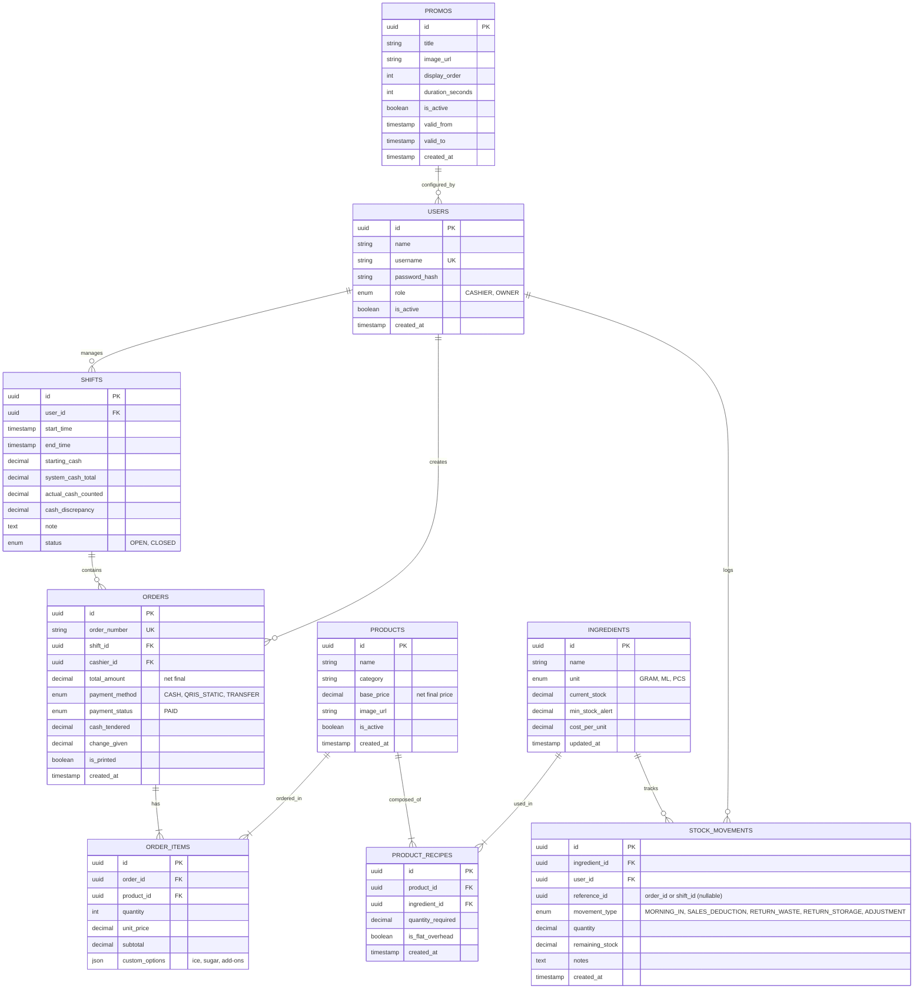

# PRODUCT REQUIREMENT DOCUMENT (PRD)
## VITAMINE — Smart POS & Inventory Management System

**Versi:** 1.1.0 (Final Approved Baseline)  
**Status:** Approved for Technical Architecture & Implementation  
**Target Rilis:** Single Store Production Ready  
**Roles:** Kasir (Shift Staff) & Owner  

---

## 1. Problem Statement

### Latar Belakang & Pihak yang Dirugikan
Operasional outlet minuman jus segar "VITAMINE" memiliki karakteristik bahan baku yang sangat mudah rusak (*perishable goods*), fluktuasi takaran racikan, dan volume transaksi tinggi pada jam sibuk. Ketiadaan sistem terintegrasi menimbulkan kerugian bagi tiga pihak:

1. **Owner (Pemilik Bisnis):**
   - **Kerugian Finansial akibat *Inventory Leakage*:** Kehilangan bahan baku (buah membusuk, takaran berlebih/kurang, *theft*) tanpa jejak audit (*audit trail*). Tidak diketahui apakah buah habis karena laku, busuk (*spoilage*), atau tidak tercatat.
   - **Ketidakpastian Arus Kas:** Sering terjadi selisih antara nilai penjualan harian di catatan dengan uang tunai fisik di laci kasir akibat ketiadaan mekanisme *cash opname* formal saat pergantian shift.
   - **Promosi Tidak Efektif:** Materi promosi statis/manual tidak fleksibel diubah dan tidak menarik perhatian antrean pelanggan di depan kasir.

2. **Kasir / Staf Barista:**
   - **Beban Mental & Risiko Tuduhan:** Menanggung risiko dituduh lalai atau curang saat terjadi selisih uang kas penutupan toko karena tidak ada serah-terima shift tercatat sistem.
   - **Operasional Lambat:** Kasir harus bolak-balik memeriksa fisik kulkas/chiller untuk memastikan apakah menu jus tertentu masih bisa dibuat atau buahnya sudah habis.

3. **Pelanggan:**
   - **Waktu Tunggu Lama:** Pelayanan lambat di meja kasir.
   - **Kekecewaan Pesanan Ditolak:** Baru mengetahui stok buah kosong setelah selesai mengantre dan memesan di kasir.

---

## 2. Target User & Persona

### Segmentasi Pengguna
1. **Kasir (Staf Shift Operasional):** Mengoperasikan terminal kasir harian menggunakan PC desktop (mouse & keyboard), menerima pesanan, mencetak struk thermal 58mm, input penerimaan stok pagi, retur stok sisa, dan rekonsiliasi kas laci.
2. **Owner (Pemilik Toko):** Mengelola master data menu, formula resep (BOM), harga beli/jual bahan baku, audit shift & selisih kas, manajemen konten display promo, serta analisis performa bisnis melalui dashboard eksekutif.

---

### Persona 1: Kasir / Barista

| Atribut | Profil |
| :--- | :--- |
| **Nama** | Rian Pratama (21 tahun) |
| **Peran** | Kasir & Barista Shift Pagi (Karyawan Shift) |
| **Karakteristik** | Multitasking, mengoperasikan PC kasir dengan mouse dan keyboard/numpad, butuh antarmuka cepat dengan shortcut keyboard. |
| **Pain Points** | - Antrean pelanggan mengular saat jam makan siang, bingung cari menu jika UI teks rumit. - Sering tidak tahu persis sisa mangga/alpukat cukup untuk berapa porsi lagi. - Takut uang laci kasir selisih saat jam serah terima shift sore ke kasir malam. |
| **Kebutuhan Utama** | - UI POS visual berupa kartu buah dengan navigasi klik mouse dan shortcut keyboard. - Tombol cepat cek sisa porsi bahan baku secara real-time. - Prosedur buka/tutup kasir (cash opname) yang memandu langkah perhitungan kas awal dan akhir secara transparan. |

---

### Persona 2: Owner

| Atribut | Profil |
| :--- | :--- |
| **Nama** | Hendra Wijaya (34 tahun) |
| **Peran** | Owner & Business Operator VITAMINE |
| **Karakteristik** | Berorientasi pada data, margin keuntungan, efisiensi bahan, dan citra brand profesional. |
| **Pain Points** | - Sering mendapati buah rusak terbuang tanpa laporan jelas apakah karena salah takar atau salah beli. - Sulit memantau performa penjualan harian secara real-time saat tidak berada di outlet. - Penggantian banner promo display pelanggan memakan waktu jika harus colok flashdisk manual ke monitor. |
| **Kebutuhan Utama** | - Dashboard metrik bisnis profesional dengan animasi dinamis (omzet, profit kotor, waste rate, grafik tren). - Sistem Bill of Materials (BOM) otomatis: 1 cup jus terjual langsung memotong gramatur buah dan sirup di sistem. - Manajemen konten GUI promo slider yang langsung ter-push ke monitor display pelanggan. |

---

## 3. Goals dan Non-Goals

### Goals (Tujuan MVP)
1. **Otomasi Pemotongan Bahan Mentah (BOM):** Memotong stok bahan baku mentah (gram/ml/pcs) secara presisi dan otomatis setiap kali transaksi penjualan berhasil diproses (gula cair dihitung sebagai *flat overhead* per cup).
2. **Kecepatan Transaksi Kasir:** Memangkas waktu input pesanan hingga cetak struk menjadi maksimal **15 detik per transaksi** menggunakan antarmuka Fruit Card POS dengan dukungan keyboard shortcut.
3. **Integritas Kas Outlet:** Menghilangkan celah manipulasi kas laci melalui workflow wajib **Buka Shift, Cash Opname Serah Terima, dan Tutup Shift**.
4. **Immutability Transaksi Pasca-Cetak:** Transaksi yang struknya telah dicetak bersifat final (*non-reversible/no-void*) untuk menjamin akurasi kasir dan pembukuan.
5. **Visibilitas Stok Real-Time:** Kasir dan Owner dapat melihat ketersediaan bahan mentah dan sisa kapasitas porsi menu dalam satu sentuhan (*one-click stock checker*).
6. **Dukungan Dual-Monitor Terintegrasi:** Menghubungkan layar utama kasir dengan monitor kedua (menghadap pelanggan) untuk menampilkan promo slider dan *live order preview*.
7. **Keandalan Cetak Fisik 58mm:** Terhubung langsung dengan printer thermal 58mm USB (ESC/POS) via WebUSB / Web Serial API di browser Chrome tanpa dialog print sistem.

### Non-Goals (Bukan Ruang Lingkup MVP)
1. **Multi-Outlet / Multi-Branch Sync:** Sistem hanya dirancang untuk 1 outlet tunggal (*single store*).
2. **Perhitungan Pajak Tambahan & Surcharge:** Harga menu yang tercantum adalah harga **net final** (tidak ada kalkulasi PB1/Pajak Restoran atau biaya takeaway terpisah).
3. **Mekanisme Void Pasca-Cetak:** Tidak ada pembatalan order setelah struk keluar (pembatalan hanya boleh dilakukan sebelum transaksi dibayar/dicetak).
4. **Automated Payment Gateway:** MVP tidak mengintegrasikan webhook dynamic QRIS atau terminal EDC kartu kredit. Pembayaran diproses dengan pencatatan nominal manual (Tunai, QRIS Statis, Transfer Bank).
5. **Self-Ordering Customer Kiosk:** Monitor pelanggan hanya bersifat display pasif (menampilkan promo dan rincian transaksi belanja), bukan layar sentuh pemesanan mandiri.
6. **Modul Akuntansi Full-Suite & Payroll:** Tidak mencakup pembukuan jurnal umum (General Ledger), neraca keuangan, atau sistem penggajian staf.

---

## 4. User Stories

| ID | Sebagai | Saya Ingin | Supaya |
| :--- | :--- | :--- | :--- |
| **US-01** | Kasir | Menginput modal kas awal saat Buka Shift | Uang di laci kasir tercatat resmi di sistem sebelum transaksi dimulai. |
| **US-02** | Kasir | Menginput bahan baku yang datang di pagi hari melalui form Order Stok Pagi | Sistem mengetahui volume stok awal bahan mentah yang siap digunakan untuk jualan hari itu. |
| **US-03** | Kasir | Menekan kartu menu buah bergambar atau menggunakan shortcut keyboard | Proses input pesanan cepat, akurat, dan dapat dilakukan via mouse/keyboard tanpa layar sentuh. |
| **US-04** | Kasir | Melihat tombol stok real-time yang menampilkan sisa estimasi porsi menu | Saya tidak menerima pesanan yang bahan bakunya sudah habis. |
| **US-05** | Kasir | Menyelesaikan transaksi dan otomatis mencetak struk thermal 58mm ke printer kasir | Pelanggan segera menerima bukti bayar fisik dan transaksi langsung terkunci final. |
| **US-06** | Kasir | Menginput sisa bahan baku yang tidak terpakai atau rusak via form Retur Stok di akhir shift | Stok di sistem kembali disesuaikan antara yang dikembalikan ke chiller vs yang terbuang (*waste*). |
| **US-07** | Kasir | Melakukan hitung fisik uang kas (*cash opname*) saat serah terima shift | Selisih kas (plus/minus) langsung terhitung transparan bersama kasir shift berikutnya / sistem. |
| **US-08** | Pelanggan | Melihat monitor display yang menampilkan slider promo menarik dan rincian harga belanjanya | Saya teredukasi promo terbaru dan merasa yakin nilai tagihan saya benar. |
| **US-09** | Owner | Mengatur banner promo, urutan slide, dan durasi tayang lewat GUI dashboard | Konten promo di monitor pelanggan selalu up-to-date tanpa perlu teknisi. |
| **US-10** | Owner | Mengatur komposisi resep bahan mentah (BOM) per menu jus | Sistem otomatis mengurangi stok buah, gula, cup, dan sedotan secara akurat setiap transaksi. |
| **US-11** | Owner | Melihat dashboard analitik animasi interaktif | Saya mendapat gambaran visual instan tentang omzet, laba kotor, menu terlaris, dan tingkat retur bahan. |
| **US-12** | Owner | Memeriksa riwayat audit shift kasir dan riwayat pergerakan stok | Tidak ada celah kecurangan uang kas maupun pencurian bahan baku. |

---

## 5. Daftar Fitur: MVP vs v2 vs Nanti

```mermaid
graph LR
    subgraph MVP [Fase 1: MVP - Live Single Store]
        A[Auth & RBAC Kasir vs Owner]
        B[Fruit Card POS Interface + Keyboard Support]
        C[Shift & Cash Opname Handover]
        D[BOM Stock Auto-Deduction Flat Sugar]
        E[Order Stok Pagi & Retur Stok]
        F[Real-time Stock Checker]
        G[Dual-Screen Promo Slider & Cart]
        H[ESC/POS Thermal Printing 58mm WebUSB]
        I[Animated Owner Dashboard]
        J[Immutable Paid Transaction Policy]
    end

    subgraph V2 [Fase 2: v2 - Optimasi & Integrasi]
        K[Payment Gateway Dynamic QRIS]
        L[WhatsApp Digital Receipt]
        M[Low-stock Auto Alert Telegram/WA]
        N[HPP & COGS Auto-Tracking]
    end

    subgraph Nanti [Fase 3: Nanti - Skalabilitas]
        O[Multi-Outlet & Central Kitchen Sync]
        P[Customer Loyalty & Membership]
        Q[AI Predictive Ordering & Spoilage Forecast]
    end

    MVP --> V2 --> Nanti
```

---

## 6. Functional Requirements Detail per Fitur MVP

### 6.1. Manajemen Shift & Cash Opname Serah Terima
- **FR-SHIFT-01:** Kasir tidak dapat mengakses layar POS sebelum menyelesaikan modal **"Buka Shift"** dengan memasukkan nominal uang kas awal (*starting cash*).
- **FR-SHIFT-02:** Sistem mencatat setiap transaksi kasir selama shift aktif dan mengkalkulasikan estimasi uang kas yang seharusnya ada di laci (*expected cash* = modal awal + total transaksi tunai).
- **FR-SHIFT-03:** Fitur **"Cash Opname Serah Terima"**:
  - Kasir memasukkan rincian pecahan uang fisik (lembar Rp100rb, Rp50rb, Rp20rb, dst, serta koin).
  - Sistem menghitung `Total Fisik` dan membandingkannya dengan `Expected Cash`.
  - Jika terdapat selisih (*variance*), kasir wajib mengisi kolom catatan keterangan alasan selisih.
  - Sistem mengunci shift tersebut dan menerbitkan nomor sesi shift baru untuk kasir berikutnya.
- **FR-SHIFT-04:** Owner memiliki akses melihat rekap seluruh sesi shift beserta selisih kas per kasir di dashboard.

### 6.2. POS Menu UI (Fruit Cards) & Transaksi (Mouse + Keyboard Optimized)
- **FR-POS-01:** Menu utama menampilkan grid kartu buah (*Fruit Cards*) yang memuat: Foto/Ilustrasi buah definisi tinggi, Nama Menu, Harga Dasar Net, dan Badge Status (*In Stock* atau *Habis*).
- **FR-POS-02 (Hardware Navigation):** Antarmuka dioptimalkan untuk navigasi **Mouse & Keyboard**:
  - Shortcut keyboard cepat: `F2` (Pencarian menu), `F4` (Cek Stok), `F8` (Pilihan Bayar Tunai), `F9` (Pilihan QRIS), `Enter` (Proses Cetak/Bayar), `Esc` (Batal item/Tutup modal).
  - Kolom input nominal bayar otomatis fokus dan mendukung input Numpad standar.
- **FR-POS-03 (Varian & Modifier):** Klik kartu buah membuka opsi varian:
  - Ukuran: Regular / Large.
  - Level Gula: Normal (100%), Less Sugar (50%), No Sugar (0%).
  - Level Es: Normal Ice, Less Ice, No Ice.
  - Topping Tambahan (Add-on): Chia seed, Yakult, Ekstra Buah.
- **FR-POS-04 (Net Pricing):** Semua harga yang tertera adalah **harga net final**. Sistem tidak menambahkan pajak PB1 atau biaya tambahan lainnya saat checkout.
- **FR-POS-05 (Immutability):** Tombol pembatalan (*Clear Cart*) hanya tersedia sebelum transaksi diselesaikan. Begitu tombol "Bayar & Cetak" ditekan dan struk mulai diproses, transaksi terkunci permanen di database (*tidak ada opsi void*).

### 6.3. Manajemen Resep & Pengurangan Stok Otomatis (BOM Deduction)
- **FR-BOM-01:** Setiap produk jadi dipetakan ke bahan baku mentah melalui Bill of Materials (BOM):
  - *Jus Buah:* Mengurangi gramatur buah spesifik sesuai resep (misal: 150 gr Buah Mangga) + 1 pcs Cup 16oz + 1 pcs Sedotan + 1 pcs Tutup Cup.
  - *Gula Cair (Overhead Flat):* Bahan gula cair dipotong dengan takaran tetap (*flat overhead*, misal: 30 ml) per cup terlepas dari pilihan tingkat gula (*Normal / Less Sugar / No Sugar*) guna simplifikasi operasional dan stabilitas inventory.
- **FR-BOM-02:** Saat transaksi sukses, sistem mengeksekusi pengurangan stok (*atomic transaction*) dan mencatat log `SALES_DEDUCTION`.
- **FR-BOM-03:** Jika salah satu bahan baku utama berada di bawah batas minimum resep, kartu buah menampilkan badge "Habis" dan tidak dapat diklik masuk keranjang.

### 6.4. Order Stok Pagi & Retur Stok Sore
- **FR-STOK-01 (Order Stok Pagi):**
  - Form input penerimaan bahan baku yang datang di pagi hari (kg/gr buah, liter sirup/gula, pcs cup).
  - Menambah `current_stock` dan mencatat movement `MORNING_IN`.
- **FR-STOK-02 (Retur Stok Sore/Malam):**
  - Form retur bahan baku sisa di akhir hari/shift.
  - Opsi klasifikasi: (1) *Waste/Spoilage* (dibuang/busuk) atau (2) *Return to Storage* (disimpan kembali di chiller).
  - Mengurangi `current_stock` counter dan mencatat movement `RETURN_WASTE` atau `RETURN_STORAGE`.

### 6.5. Tombol Cek Stok Real-Time
- **FR-CHK-01:** Tombol header / floating button berlabel **"Cek Stok (F4)"**.
- **FR-CHK-02:** Menampilkan modal cepat berisi daftar stok bahan baku mentah dan estimasi konversi sisa porsi cup yang dapat dibuat (disertai indikator warna hijau/kuning/merah).

### 6.6. Modul Cetak Struk Thermal 58mm (Direct ESC/POS)
- **FR-PRN-01:** Sistem terhubung langsung ke printer thermal **58mm via WebUSB / Web Serial API** pada Google Chrome desktop.
- **FR-PRN-02:** Format struk disesuaikan untuk kertas 58mm (lebar karakter 32 kolom):
  - Header: Nama "VITAMINE", Info Outlet, Tanggal/Jam, No. Order, Kasir.
  - Body: Item, Qty, Harga Satuan, Subtotal.
  - Footer: Total Nett, Tunai, Kembalian, Ucapan Terima Kasih.
- **FR-PRN-03:** Struk dicetak secara langsung (*silent printing*) tanpa memunculkan dialog print sistem OS yang mengganggu ritme kasir.
- **FR-PRN-04:** Tersedia fitur *Re-print Struk Terakhir* (khusus jika kertas macet saat cetak pertama).

### 6.7. Dual-Monitor Customer Facing Display (Promo Slider & Cart)
- **FR-DISP-01:** Rute `/customer-display` dibuka di monitor sekunder PC kasir via mode fullscreen (F11).
- **FR-DISP-02:** Sinkronisasi state via `BroadcastChannel API`:
  - **Idle State:** Menampilkan Slider Promosi penuh dengan transisi dinamis.
  - **Cart Active State:** Otomatis beralih ke layout split: 60% rincian belanja pelanggan (nama item, varian, harga net, total) dan 40% slider promo.
  - **Payment State:** Menampilkan total tagihan dan QRIS Statis saat kasir memilih metode QRIS.

### 6.8. GUI Manajemen Promo Slider (Dashboard Owner)
- **FR-PROMO-01:** Owner dapat mengunggah gambar banner (rekomendasi rasio 16:9), mengatur urutan tayang (*drag-and-drop*), durasi tayang (detik), dan toggle aktif/nonaktif.
- **FR-PROMO-02:** Perubahan langsung terupdate ke monitor display secara instan tanpa reload browser.

### 6.9. Dashboard Analitik Animatif (Owner)
- **FR-DASH-01:** Desain modern dengan animasi halus (Framer Motion / Chart.js):
  - Kartu KPI angka animasi: Omzet Kotor (Nett), Total Transaksi, Nilai Bahan Terbuang (*Waste*).
  - Grafik tren penjualan harian/mingguan.
  - Diagram Donat: Menu Buah Terlaris (*Top Selling*).
  - Rekapitulasi sesi shift kasir beserta status variansi kas laci (*Zero, Minus, Surplus*).

---

## 7. Sketsa Data Model (Entitas + Field Kunci)

---

## 8. Edge Case & Failure State

| Skenario Edge Case / Kegagalan | Kemungkinan Dampak | Penanganan Sistem (Mitigasi) |
| :--- | :--- | :--- |
| **Permintaan Batal Pasca-Cetak Struk** | Pelanggan berubah pikiran setelah struk keluar. | **Aturan Ketat (No-Void):** Sistem tidak menyediakan tombol void/batal setelah struk dicetak. Transaksi tetap sah dan tercatat. Kebijakan pergantian minuman ditangani secara manual/operasional tanpa mengubah pembukuan sistem. |
| **Kertas Printer Macet / Habis di Tengah Cetak** | Struk terpotong sebagian atau tidak keluar. | Tombol *"Re-print Struk Terakhir"* disediakan di antarmuka kasir tanpa menduplikasi data transaksi di database. |
| **Bahan Baku Kurang Saat Checkout** | Selisih stok fisik vs sistem menyebabkan buah habis sebelum order diproses. | Sistem menolak checkout jika `current_stock` < BOM. Kasir diarahkan untuk mengecek stok fisik dan meminta Owner/Kasir menginput penyesuaian (*Stock Adjustment*). |
| **Monitor Pelanggan Terputus (Kabel Lepas)** | Layar promo sekunder mati/freeze. | Indikator status display di layar kasir berubah menjadi abu-abu/merah. Tidak mengganggu alur checkout di layar utama. |
| **Selisih Kas Opname Signifikan** | Uang kas di laci tidak sesuai dengan kalkulasi sistem saat serah terima. | Sistem mewajibkan pengisian catatan keterangan selisih (minimal 20 karakter) sebelum shift dapat ditutup, dan otomatis menandai sesi tersebut dengan highlight merah di dashboard Owner. |

---

## 9. Success Metrics (Metrik Keberhasilan MVP)

1. **Transaction Checkout Velocity:** Rata-rata durasi checkout dari pemilihan menu hingga struk 58mm selesai tercetak adalah **< 15 detik** per transaksi.
2. **Stock Discrepancy Rate:** Selisih antara perhitungan stok bahan baku fisik dengan data sistem di bawah **< 2%** dari total pergerakan mingguan.
3. **Shift Handover Duration:** Waktu yang dihabiskan kasir untuk proses *Buka Shift* atau *Cash Opname Serah Terima* **< 3 menit** per sesi.
4. **Hardware Printing Reliability:** Tingkat keberhasilan cetak struk thermal 58mm tanpa error teknis mencapai **≥ 99.5%** dari seluruh transaksi sukses.
5. **System Availability:** Uptime aplikasi selama jam operasional outlet (08.00 - 22.00) mencapai **99.9%** tanpa crash yang menghentikan kasir.

---

## 10. Keputusan Arsitektur Final (Closed Decisions)

Seluruh pertanyaan terbuka telah disepakati dan dikunci sebagai acuan implementasi:

1. **Kebijakan Pembatalan (Void):**  
   *Keputusan:* Tidak ada fitur void atau otorisasi PIN. Begitu struk dicetak, transaksi berstatus final (*immutable*) dan tidak dapat dibatalkan di sistem.
2. **Presisi Bahan Baku Gula Cair:**  
   *Keputusan:* Gula cair dicatat sebagai *flat overhead* (takaran tetap per cup) dalam resep BOM, tanpa variasi pemotongan proporsional untuk level kemanisan.
3. **Spesifikasi Printer Kasir:**  
   *Keputusan:* Printer thermal format **58mm**, terhubung via USB dengan protokol ESC/POS langsung menggunakan WebUSB / Web Serial API di browser Chrome.
4. **Navigasi Perangkat Kasir:**  
   *Keputusan:* Menggunakan PC desktop dengan **Mouse & Keyboard** (dilengkapi shortcut tombol fungsi `F2`, `F4`, `Enter`, `Esc`, dan numpad input).
5. **Struktur Harga & Pajak:**  
   *Keputusan:* Semua harga pada kartu buah adalah **harga net final**. Tidak ada kalkulasi pajak PB1 atau biaya tambahan bungkus/takeaway.
